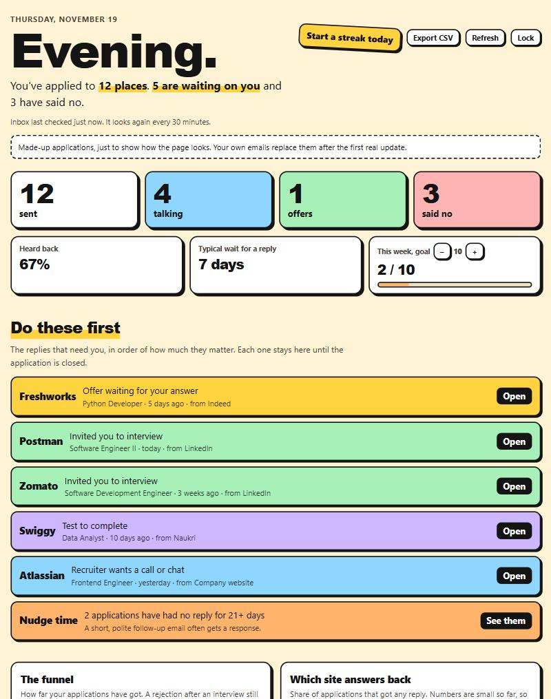
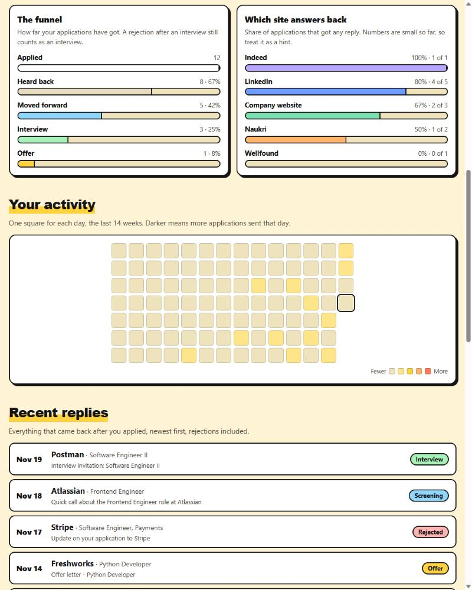

# Job Hunt

A free, private web page that keeps track of your job applications by reading your Gmail for you.

When you apply for jobs, the replies pile up fast: confirmations, "we'll be in touch", a call from a recruiter, a rejection two weeks later. They come from LinkedIn, Naukri, Indeed and a dozen company career pages, and after a month it is hard to say what you sent where or who still owes you an answer. This project reads those emails every 10 minutes or so and keeps one tidy list up to date. You open the page on your phone or laptop, type a passphrase, and see where everything stands.



The screenshots use made-up applications.

## What you see

- **A summary in plain words.** "You've applied to 55 places. 2 are waiting on you and 3 have said no."
- **Four big numbers:** how many you have sent, how many are talking to you, how many offers, and how many said no. Beside them: the share of applications that got any reply, the typical wait for one, and a weekly goal you can change.
- **Do these first.** One coloured row for each employer that wants something: an offer to answer, an interview, a test, or a recruiter who wants a call. Each row stays until the application is closed. If some applications have had no reply for three weeks, a "Nudge time" row suggests a polite follow-up.
- **The funnel.** How far your applications have got: applied, heard back, moved forward, interview, offer.
- **Which site answers back.** The share of applications that got a reply, for LinkedIn, Naukri, Indeed and every other site you used, from your own history. With few applications the numbers are only a hint.
- **Your activity.** A square for each of the last 14 weeks' days, darker when you sent more applications, plus a streak counter for consecutive days.
- **Recent replies.** Everything that came back after you applied, newest first, rejections included. Anything that arrived since your last visit is marked "New".
- **The full list.** Tabs for everything, moving forward, waiting, no reply and rejected. Filter by job site, search by company, and open any row to see its email trail. A link on every row opens the original email in Gmail.
- **Every application is tagged with the site it came from:** LinkedIn, Naukri, Indeed, Wellfound, Glassdoor, a company's own careers page, and so on. Each site has its own colour.
- **Export to a spreadsheet** with one button, and install it on your phone's home screen.
- **Phone alerts (optional).** A buzz on your phone when a screening call, test, interview, offer or rejection arrives. The alert only says what kind of reply it was, such as "1 interview invite", and never names the company. You tap it to open your dashboard. Interviews and offers, recruiter calls and tests, and rejections arrive at three levels, so on Android you can give each its own sound.



## How it works

Think of a helper who checks your inbox every ten minutes or so. The helper only reads. It looks for emails about job applications, notes which site each one came from and what stage it shows, writes the result into a locked box, and puts the box on a web page. Your browser has the key (your passphrase), so only you can open it.

```
Your Gmail  →  a small program  →  a locked data file  →  the web page
(read only)    (runs on GitHub      (unreadable without    (opens it in
               every 10 minutes)     your passphrase)       your browser)
```

The program is plain pattern matching on the sender, the subject and the first lines of each email. It does not use any AI service, nothing is sent to anyone except GitHub, and nothing costs money.

## Is it private?

The code and the web page are public, because GitHub's free plan only offers web pages for public projects. Your job list is not public. It is stored encrypted (AES-256), and the key comes from your passphrase. Someone who finds the page sees a lock screen. Someone who downloads the data file sees noise.

Some more detail:

- The program has **read-only** access to your Gmail. It cannot send, delete or change anything.
- Your Google login details are kept in GitHub's encrypted secret store, which nobody can read back, including you.
- The program runs on GitHub's computers for about two minutes each time. The emails it reads pass through that machine and are not kept. If you are not comfortable with that, do not use this project.
- Public projects have public logs, so the program prints nothing about your jobs while it runs.
- Phone alerts are off unless you switch them on. They go through ntfy, a free outside service. It receives a short line such as "1 interview invite" and the time, and never a company name or email text. It does learn that something arrived, so skip alerts if that bothers you. See [Setup, part 8](docs/SETUP.md#part-8-phone-alerts-optional).
- **Your passphrase is the only lock.** Pick a long one, such as four or five unrelated words. A short or common one could be guessed by someone who copies the encrypted file and tries many passphrases on their own computer. If you forget it, it cannot be recovered. You can set a new one and run the update again.

## What you need

| | |
|---|---|
| **Time** | About 30 to 45 minutes the first time. You do the setup once. |
| **Cost** | Nothing. You never need to enter a card. If Google Cloud shows a banner offering free credits or a trial, ignore it. |
| **Skills** | None. You will copy and paste a few commands, and the setup guide says exactly what you should see at each step. |
| **Accounts** | A Gmail account that receives your application emails, and a free GitHub account. |
| **Software** | Python 3.10 or newer on one computer, only for a one-time login step. |

Only Gmail is supported. It has been tried on Windows. The Python parts should work on Mac and Linux, but that has not been tested.

## Set it up

The full walkthrough is in **[docs/SETUP.md](docs/SETUP.md)**. In short:

1. Copy this project to your own GitHub account.
2. Give it read-only access to your Gmail through a free Google Cloud project.
3. Log in once on your computer to get a key the program can keep using.
4. Store that key and your passphrase in GitHub.
5. Switch on the web page and run the first update.

If something goes wrong, look in **[docs/TROUBLESHOOTING.md](docs/TROUBLESHOOTING.md)**, which lists the messages you might see and what to do about each.

## Using the page

Open the address `https://YOUR-GITHUB-NAME.github.io/job-tracker/` and enter your passphrase. Tick "Remember me on this device" if it is your own phone or computer.

**The stages.** Each application has one status, which is the latest news about it:

| Status | What it means |
|---|---|
| Applied | You sent your application. This is the starting point. |
| In review | They have opened it or are looking at it. |
| Screening | A recruiter wants a first call or chat, or has said you are shortlisted or moving to the next step. |
| Assessment | You were sent a test or a take-home task. |
| Interview | You were invited to interview. |
| Offer | They sent an offer. |
| Rejected | They said no, or the role was filled. Once a rejection arrives, later emails from that employer do not change it. |

**Small things worth knowing**

- A small orange **?** after a company name means the company or role was guessed from the email. Click the Gmail link on that row to check the original.
- **New** appears on anything that arrived since you last had the page open.
- Click any row to see every email that belongs to that application, in order.
- **Refresh** loads the latest data without reloading the page. **Lock** forgets your passphrase on this device.
- **Export CSV** saves every application as a spreadsheet file that opens in Excel or Google Sheets.
- The weekly goal (the + and – next to "This week") is remembered on that device only. The default is 10 applications a week.
- Press **Ctrl + K** (Cmd + K on a Mac), or **/**, to jump to the search box.
- An application counts as "no reply" when nothing has come back for 21 days.
- "Heard back" counts any real answer: a call, a test, an interview, an offer or a rejection. Automatic confirmations and "your application was viewed" notices do not count.
- The page follows your phone or computer's light or dark setting.

## What it gets wrong

It matches patterns, so it is not perfect.

- Companies word their emails in many ways. Now and then the company, the role or the stage is misread. Expect a few rows to need a quick look.
- It is built around English-language emails.
- It does not read interview dates or times. A card tells you when the email arrived and links to it.
- Newsletters and job alerts are skipped by a list of phrases. A new kind of newsletter can slip through, and an unusual reply can be missed.
- Statuses cannot be changed by hand. They always follow the emails.
- Each update looks at the last 365 days, up to 1,500 emails.

If a real email is sorted wrongly, the fix is usually one new line in the rules. See **[docs/CUSTOMIZING.md](docs/CUSTOMIZING.md)**, which also shows how to add a job site.

## Questions people ask

**Does it work with Outlook, Yahoo or other mail?** No, only Gmail.

**Will it tell me when something arrives?** The page itself does not push anything. If you want a buzz on your phone for interviews, calls, offers and rejections, switch on the optional phone alerts (setup guide, part 8). Gmail's own notifications keep working as before.

**Can other people see my applications?** No, as long as your passphrase is long and private. See "Is it private?" above.

**Why does Google show an "unverified app" warning?** Because you made the app yourself and Google has not reviewed it. You are the only user. You click through the warning once.

**Do I need to keep my computer on?** No. After setup, GitHub does the work.

**Can I use it for a friend?** Each person should set up their own copy with their own Google project and passphrase. Do not share login files.

**How do I stop it?** Remove the app at <https://myaccount.google.com/permissions>, then delete the GitHub project.

## What is in this folder

| File | What it does |
|---|---|
| `site/index.html` | The page you look at. It loads nothing from other websites. |
| `site/manifest.webmanifest`, `site/icon.svg` | What lets you add the page to your phone's home screen. |
| `site/privacy.html` | The privacy page Google asks for. Edit it so it names you. |
| `classify.py` | The rules that decide the site, stage, company and role for each email. |
| `build_data.py` | Fetches the emails, builds the list and encrypts it. |
| `get_token.py` | The one-time Google login helper. |
| `set-secrets.ps1` | An optional Windows shortcut for storing the secrets in GitHub. |
| `alerts.py`, `setup-alerts.ps1` | The optional phone alerts, and a Windows shortcut to switch them on. |
| `.github/workflows/update.yml` | The 10-minute schedule. |
| `tests/test_classify.py` | Sample emails that check the rules still work. |
| `docs/` | The guides and the screenshots. |

## Guides

- [Setup guide](docs/SETUP.md): every step, for people who have never done this before.
- [Troubleshooting](docs/TROUBLESHOOTING.md): error messages and what to do.
- [Customizing](docs/CUSTOMIZING.md): adding a job site or new wording, how the rules work, and how to run the tests.

## License

MIT. You may use, copy, change and share this project, including for your own job search, as long as you keep the licence notice. See [LICENSE](LICENSE). It comes with no warranty.
